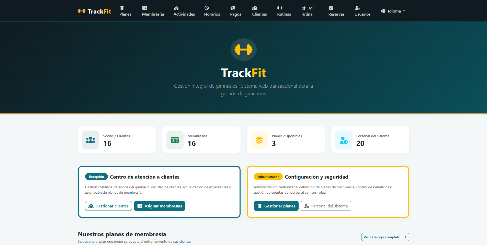

# 👨‍💻 Daniel Barrientos Salas — Portfolio

**IT Technician | Systems Engineering Student**

---

## About Me

I'm an IT Technician and Systems Engineering student at Universidad Fidélitas (Costa Rica).
I have hands-on experience in Level 1 technical support, Linux/Windows systems, networking, cloud services, and software development.

- 🎓 Ingeniería en Sistemas de Computación — Universidad Fidélitas *(In progress)*
- 🏫 Técnico Medio en Configuración y Soporte a Redes de Comunicación y Sistemas Operativos — CTP San Pedro de Barva
- 🌐 English: B2 Intermediate

---

## 🛠️ Tech Stack

| Area | Technologies |
|------|-------------|
| **Languages** | Java, Python, Bash, JavaScript, SQL |
| **Backend** | Spring Boot, Spring Data JPA / Hibernate, JDBC, Java Sockets |
| **Web & UI** | HTML, CSS, JavaScript, Thymeleaf, Bootstrap, Java Swing |
| **Databases** | MySQL |
| **Cloud** | Microsoft Azure, Oracle Cloud Infrastructure |
| **Networking** | CCNAv7, IP addressing, routers & switches |
| **OS** | Windows 10/11, Ubuntu Desktop, Ubuntu Server |
| **Tools** | Git, GitHub, Maven, VirtualBox |

---

## 📁 Projects

### 🏋️ TrackFit — Gym Management Web System
> **Course:** SC-403 Desarrollo de Aplicaciones Web y Patrones — Universidad Fidélitas
> **Status:** 🚧 In development (functional, group project of 4 members)

Transactional web application to manage the main operations of a small or medium gym in one place, with three membership levels (Standard, Premium and VIP) that define each client's benefits and booking restrictions.

- Management of users, clients, membership plans, payments and activities
- Class schedules with maximum capacity and reservations with spot control
- Business rules by plan: valid membership required and booking window based on the client's plan
- Training routines with exercises, sets and repetitions
- Layered MVC architecture (Controller, Service, Repository, Domain) with Bean Validation
- Relational database with 16 tables
- Collaborative workflow with feature branches and reviewed pull requests

**Tech:** `Java 21` `Spring Boot` `Spring Data JPA` `Thymeleaf` `Bootstrap` `MySQL` `Maven` `Git`

🔗 [View Repository](https://github.com/Daniels2405/TrackFit)

---

### 📦 QuickDelivery S.A — Delivery Management & Monitoring System
> **Course:** Programación Cliente/Servidor Concurrente — Universidad Fidélitas

Distributed client/server desktop application for managing package deliveries with real-time monitoring.

- Client/server communication through a custom TCP protocol using Java Sockets
- Multithreading for concurrent request handling
- Multilayer architecture with three user roles: Administrator, Dispatcher and Driver
- Complete audit log of system activity
- Graphical interface with Java Swing and database integration with JDBC

**Tech:** `Java 17` `Sockets` `Multithreading` `Swing` `JDBC` `MySQL 8` `Maven`

🔗 [View Repository](https://github.com/Daniels2405/Gesti-n-y-Monitoreo-de-Entregas-QuickDelivery-S.A)

---

### 🏭 Sistema Centro de Distribución — Warehouse Management System
> **Course:** Programación Cliente/Servidor — Universidad Fidélitas

Client/server desktop application for managing warehouses and boxes in a distribution center.

- Full CRUD for warehouses and boxes via TCP sockets
- Serialized Java objects (Request/Response) as communication protocol
- MVC architecture with DAO layer for database access
- Multithreading with one thread per connected client

**Tech:** `Java` `Sockets` `Swing` `JDBC` `MySQL` `Maven`

🔗 [View Repository](https://github.com/Daniels2405/Sistema_Centro_De_Distribuci-n)

---

## 📜 Certifications

| Certification | Issuer | Year |
|--------------|--------|------|
| Microsoft Azure Fundamentals (AZ-900) | Microsoft | 2025 |
| Oracle Cloud Infrastructure Foundations | Oracle | 2025 |
| GitHub Foundations | GitHub | 2025 |
| Scrum Fundamentals Certified | SCRUMstudy | 2026 |
| CCNAv7: Introduction to Networks | Cisco Networking Academy | 2023 |
| Cybersecurity Essentials | Cisco Networking Academy | 2023 |
| NDG Linux Essentials | Cisco Networking Academy | 2024 |
| IT Essentials: PC Hardware and Software | Cisco Networking Academy | 2022 |
| Introduction to IoT | Cisco Networking Academy | 2022 |
| Programming Essentials in Python | Cisco Networking Academy | 2022 |

---

## 💼 Experience

**Soporte Técnico Nivel 1 — Nutricare** *(Oct 2024 – Dec 2024)*
- Level 1 technical support (on-site and remote via Microsoft Teams)
- Preventive and corrective maintenance of laptops, mobile devices and printers
- Technical documentation and user manuals
- Structured cabling installation and network cabinet reorganization

---

## 📬 Contact

- **Email:** dn.barrientossalas@gmail.com
- **LinkedIn:** [daniel-barrientos-salas](https://linkedin.com/in/daniel-barrientos-salas-1a7218340/)
- **GitHub:** [Daniels2405](https://github.com/Daniels2405)